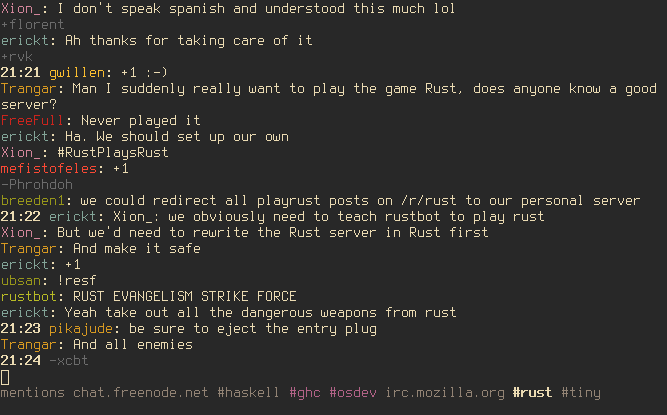
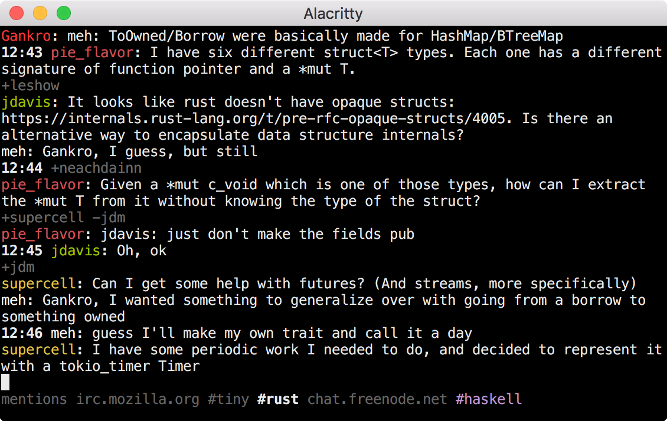

# tiny - Yet another terminal IRC client

tiny is an IRC client written in Rust.

<p float="left" align="middle">
  
  
  
</p>

## Features

- Clean UI: consecutive join/part/quit messages are shown in a single line, time
  stamps for a message is omitted if it's the same as the message before.
  (inspired by [irc-core](https://github.com/glguy/irc-core))

- All mentions to the user are collected in a "mentions" tab, including server
  and channel information. "mentions" tab solves the problem of missing mentions
  to you in channels after hours of inactivity.

- Mentions to the user in a channel is highlighted (the channel tab is also
  highlighted in the tab list)

- Simple config file format for automatically connecting to servers, joining
  channels, registering the nickname etc. See [configuration
  section](#configuration) below.

- Tab-completion for command names and channel nicks

- Nicks in channels are colored.

- Disconnect detection and automatic reconnects. You can keep tiny running on
  your laptop and it automatically reconnects after a sleep etc.

- Configurable key bindings inspired by terminal emulators and vim. See [key
  bindings section](#key-bindings) below.

- Configurable colors

- SASL authentication

- Configurable desktop notifications for channel mentions and private messages
  by default

- znc compatible

- TLS support

## Installation

tiny works on Linux and OSX. Windows users can run it under Windows Subsystem
for Linux.

For pre-built binaries see [releases]. To build from source, use a current
stable Rust toolchain. By default tiny uses [rustls] for TLS support and enables
desktop notifications for channel mentions and private messages. Configure
`notify: off` or use `/notify` to change notification settings.

[releases]: https://github.com/osa1/tiny/releases
[rustls]: https://github.com/ctz/rustls

On Linux, Cargo builds with notifications require `pkg-config` and the libdbus
development package (for example, `libdbus-1-dev` on Debian/Ubuntu). At runtime,
a D-Bus session and a notification service are required. On macOS,
notifications may be attributed to Finder, so Finder's notification permission
settings can affect their display.

- To build without notifications while retaining rustls, add
  `--no-default-features --features=tls-rustls`.
- To use the system TLS library (OpenSSL or LibreSSL) with notifications, add
  `--no-default-features --features="tls-native desktop-notifications"`.
  This also requires OpenSSL or LibreSSL headers and runtime libraries on Linux.
- For a musl build with notifications, add
  `--features=desktop-notifications-static-linking` to build libdbus from
  vendored sources.

To install in a clone:

```
cargo install --path crates/tiny
```

If you don't want to clone the repo, you can use

```
cargo install --git https://github.com/sunao1222/tiny --branch dev
```

If you have an older version installed, add `--force` to the command you're
using.

Arch Linux users can install the latest [stable] and [development] versions
of tiny through the AUR.

[stable]: https://aur.archlinux.org/packages/tiny/
[development]: https://aur.archlinux.org/packages/tiny-git/

tiny is tested on Linux and OSX.

### Nix

With Nix flakes enabled, build the default rustls-based package, which enables
desktop notifications, or enter the development shell from the repository root:

```sh
nix build
./result/bin/tiny --version
nix develop
```

The package and shell use the same rust-overlay toolchain selected by
`rust-toolchain` (currently `stable`). Its default profile includes `rustc`,
`cargo`, `rustfmt`, `clippy`, and Rust documentation. The shell also includes
the Linux dependencies needed for native TLS and desktop notifications. For
example, inside the shell:

```sh
cargo test --workspace
cargo test -p tiny --no-default-features --features "tls-native desktop-notifications"
```

Tests that require an IPv6 loopback listener are skipped when it is unavailable;
their IPv6 behavior is then unverified. Pass `-- --nocapture` to `cargo test`
to see the skip diagnostics.

`flake.lock` pins nixpkgs, Home Manager, and rust-overlay, and `Cargo.lock` pins
Rust dependencies. The flake declares package outputs for x86_64 and aarch64 on
Linux and macOS. The pinned nixpkgs 26.11 does not support `x86_64-darwin`, so
that package cannot currently be evaluated. In a Git checkout, Nix includes
only files known to Git, so add newly created source files before building.
Format the Nix expressions with:

```sh
nix fmt -- flake.nix shell.nix nix/package.nix nix/home-manager.nix nix/tests/home-manager.nix
```

#### Home Manager

With Home Manager 26.05, add `github:sunao1222/tiny/dev` as a flake input named `tiny`.
Use `tiny.packages.${system}.default` as a package, or include
`tiny.homeManagerModules.default` in the modules passed to
`home-manager.lib.homeManagerConfiguration`:

```nix
modules = [
  tiny.homeManagerModules.default
  {
    programs.tiny = {
      enable = true;
      config = builtins.readFile ./tiny.yml;
      # Alternatively, use an inline YAML string:
      # config = '' ... '';
    };
  }
];
```

The module extends Home Manager's existing `programs.tiny` module. Its default
package comes from this flake; set `programs.tiny.package` to override it.
`programs.tiny.config` writes the YAML string unchanged, including comments and
newlines, to `$XDG_CONFIG_HOME/tiny/config.yml` on Linux or
`~/Library/Application Support/tiny/config.yml` on macOS. It is mutually
exclusive with the upstream `programs.tiny.settings` option; leave `config`
unset to use `settings` instead.

On `x86_64-darwin`, override the package with one from a supported package
set, for example `programs.tiny.package = pkgs.tiny;` when `pkgs` is from
nixpkgs 26.05. The flake's default package cannot be evaluated on that system.

Home Manager places the YAML in the world-readable Nix store. Do not put
passwords or other secrets in it. Existing Home Manager configurations should
keep their current `home.stateVersion`.

## Configuration

tiny looks for these places for a config file:

- On Linux: `$XDG_CONFIG_HOME/tiny/config.yml`, on macOS:
  `$HOME/Library/Application Support/tiny/config.yml`
- (when not found) `$HOME/.config/tiny/config.yml`
- (when not found, deprecated) `$HOME/.tinyrc.yml`

When a config file is not found in one of these locations tiny creates one in
the first path above with defaults and exits, printing path to the config file.
Edit that file before re-running tiny to change the defaults.

For an IPv6 server, use an unbracketed `addr`, such as `::1` or
`fe80::1%lo`, and specify `port` separately. A scope ID is retained for the
connection but omitted from the IP address used to verify the TLS certificate.

**A note on nick identification:** Some IRC servers such as ircd-seven (used by
Freenode) and InspIRCd (used by Mozilla) support identification via the `PASS`
command. This way of identification (rather than sending a message to a service
like `NickServ`) is better when some of the channels that you automatically
join require identification. To use this method enter your nick password to the
`pass` field in servers.

### Per-server proxies

Each server may specify a `proxy` with `type` (`http`, `https`, `socks4`, or
`socks5`), `addr`, and `port`. Omitting `proxy` or setting it to `null` connects
directly. For example:

```yaml
proxy:
  type: socks5
  addr: 127.0.0.1
  port: 1080
  username: example
  password:
    command: 'pass show proxy-password'
```

HTTP and HTTPS use Basic authentication; SOCKS5 uses username/password.
Specify both credentials or neither. SOCKS4 accepts `username` as its USERID
but does not accept a password. SOCKS5 proxies may choose no authentication
even when credentials are configured.

HTTPS protects the connection to the proxy independently of the server's
`tls` setting. Credentials sent to other proxy types are not encrypted in
transit. SOCKS4 uses remote DNS (SOCKS4a) by default; set `socks4a: false` to
resolve the IRC host locally and use IPv4-only SOCKS4 instead.

`/connect` uses a matching configured server's proxy even if that server is not
autoconnected or was excluded by command-line filters. If multiple servers
share a hostname, the requested port must select exactly one of them.
Reconnecting switches to the selected server's proxy, including an explicit
direct connection; with no matching server configuration, it keeps the current
proxy.

Scoped IPv6 destinations (such as `fe80::1%eth0`) cannot be represented safely
by proxy protocols and are rejected when a proxy is configured.

### Using external commands for passwords

When a password field in the config file is a map with a `command` key, the
value is used as the shell command to run to get the password.

For example, in this config:

```yaml
sasl:
  username: osa1
  password:
    command: 'pass show "my irc password"'
```

tiny runs the `pass ...` command and uses last line printed by the command as
the password.

## Command line arguments

By default (i.e. when no command line arguments passed) tiny connects to all
servers listed in the config. tiny considers command line arguments as patterns
to be matched in server addresses, so you can pass command line arguments to
connect to only a subset of servers specified in the config. For example, in
this config:

```yaml
servers:
    - addr: irc.libera.chat
      ...

    - addr: irc.gnome.org
      ...
```

By default tiny connects to both servers. You can connect to only the first
server by passing `libera` as a command line argument.

You can use `--config <path>` to specify your config file location.

## Key bindings

Key bindings can be configured in the config file, see the [wiki
page][key-bindings-wiki] for details.

Default key bindings:

- `C-a`/`C-e` move cursor to beginning/end in the input field

- `C-k` delete rest of the line

- `C-w` delete a word backwards

- `C-left`/`C-right` move one word backward/forward

- `page up`/`page down`, `shift-up`/`shift-down`, or `C-u`/`C-d` to scroll

- `C-n`/`C-p` next/previous tab

- `C-c enter` quit (asks for confirmation)

- `alt-{1,9}` switch to nth tab

- `alt-{char}` switch to next tab with underlined `char`

- `alt-0` switch to last tab

- `alt-left/right` move tab to left/right

- `C-x` edit current message in `$EDITOR`

[key-bindings-wiki]: https://github.com/osa1/tiny/wiki/Configuring-key-bindings

## Commands

Commands start with `/` character.

Press `Tab` within a command name to complete it. Press `Tab` or the up/down
arrow keys to cycle through matches. Completion is case-sensitive, preserves
existing arguments, and does not add a space. Nick completion remains available
in messages and command arguments.

When text and `Tab` arrive in the same terminal read, tiny treats them as pasted
text rather than separate key presses. In that case, completion does not run;
this preserves multiline paste handling.

- `/help`: Show help messages of commands listed below.

- `/msg <nick> <message>`: Send a message to a user. Creates a new tab.

- `/join <channel>`: Join to a channel

- `/close`: Close the current tab. Leaves the channel if the current tab is a
  channel. Leaves the server if the tab is a server. You can use `/close <reason>` to send a goodbye message.

- `/connect <host>:<port> [<password>]` or `/connect [<IPv6>]:<port> [<password>]`:
  Connect to a server using the nick, realname, TLS and auto-join settings in
  `defaults`. For example, `/connect [::1]:6667` or
  `/connect [fe80::1%lo]:6697`.

- `/connect`: Reconnect to the current server. Use if you don't want to wait
  tiny to reconnect automatically after a connectivity problem.

- `/away <msg>`: Set away status

- `/away`: Remove away status

- `/nick <nick>`: Change nick

- `/names`: List all nicks in the current channel. You can use `/names <nick>` to
  check if a specific nick is in the channel.

- `/reload`: Reload TUI configuration

- `/clear`: Clears tab contents

- `/switch <string>`: Switch to the first tab which has the given string in the name.

- `/ignore`: Ignore `join/quit` messages in a channel. Running this command in
  a server tab applies it to all channels of that server. You can check your
  ignore state in the status line.

- `/notify [off|mentions|messages]`: Enable and disable desktop notifications.
  Running this command in a server tab applies it to all channels of that
  server. You can check your notify state in the status line.

- `/quit`: Quit. You can use `/quit <reason>` to send a goodbye message.

## Server commands

For commands not supported by tiny as a slash command, sending the command in
the server tab will send the message directly to the server.

### Examples:

- `LIST` will list all channels on the server
- `MOTD` will display the server Message of the Day
- `RULES` will display server rules
- etc...

## Community

Join us at #tiny in [irc.oftc.net][oftc] to chat about anything related to tiny!

[oftc]: https://www.oftc.net/
